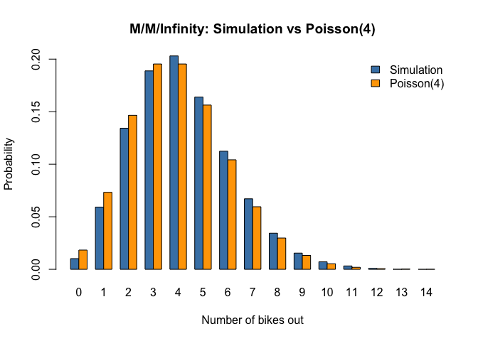

# HW10


Problem 2(c)

## Gillespie simulation

``` r
set.seed(123)

lambda <- 12
mu <- 3
rho <- lambda / mu
T <- 500

t <- 0
n <- 0
time_in_state <- numeric(1)

while (t < T) {
  rate <- lambda + n * mu
  dt <- rexp(1, rate = rate)

  duration <- min(dt, T - t)

  if (n + 1 > length(time_in_state)) {
    time_in_state <- c(time_in_state, 0)
  }

  time_in_state[n + 1] <- time_in_state[n + 1] + duration
  t <- t + duration

  if (t >= T) break

  if (runif(1) < lambda / rate) {
    n <- n + 1
  } else {
    n <- n - 1
  }
}
```

## Compare simulated and theoretical probabilities

``` r
states <- 0:(length(time_in_state) - 1)
sim_prob <- time_in_state / T
theory_prob <- dpois(states, lambda = rho)

# Include unvisited states for comparison
max_state <- max(max(states) + 1, ceiling(rho))
all_states <- 0:max_state

sim_prob <- c(
  sim_prob,
  rep(0, length(all_states) - length(sim_prob))
)

theory_prob <- dpois(all_states, lambda = rho)

barplot(
  rbind(sim_prob, theory_prob),
  beside = TRUE,
  names.arg = all_states,
  col = c("steelblue", "orange"),
  xlab = "Number of bikes out",
  ylab = "Probability",
  main = "M/M/Infinity: Simulation vs Poisson(4)",
  legend.text = c("Simulation", "Poisson(4)"),
  args.legend = list(x = "topright", bty = "n")
)
```



## Largest difference and time average

``` r
max_diff <- max(abs(sim_prob - theory_prob))

time_avg <- sum(all_states * sim_prob)

cat("Largest absolute difference:", max_diff, "\n")
```

    Largest absolute difference: 0.01404219 

``` r
cat("Simulated time average:", time_avg, "\n")
```

    Simulated time average: 4.201635 

``` r
cat("Theoretical mean:", rho, "\n")
```

    Theoretical mean: 4 

``` r
cat("Difference in means:", abs(time_avg - rho), "\n")
```

    Difference in means: 0.2016353 

## Minimum fleet size

Find the smallest integer c such that P(X \> c) \<= 0.01.

``` r
c <- qpois(0.99, lambda = rho)

cat("Minimum fleet size:", c, "\n")
```

    Minimum fleet size: 9 

``` r
cat("P(X > c):", ppois(c, rho, lower.tail = FALSE), "\n")
```

    P(X > c): 0.008132243 

``` r
cat("P(X > c - 1):",
    ppois(c - 1, rho, lower.tail = FALSE), "\n")
```

    P(X > c - 1): 0.02136343 
