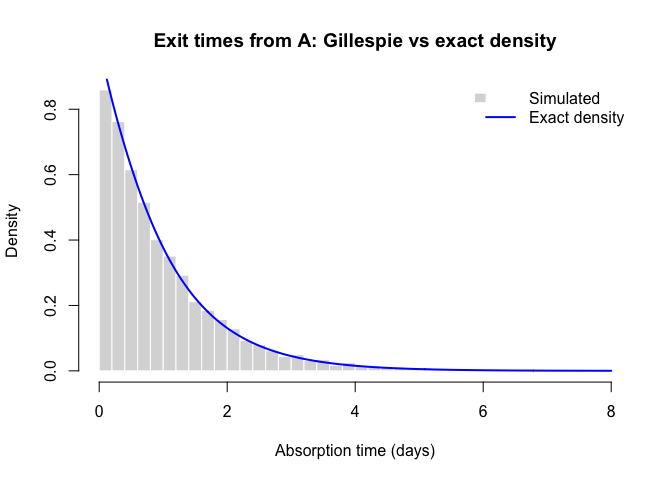
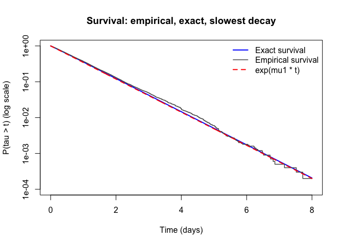

# HW11


Problem 2(c)

``` r
set.seed(5100)

states <- c("A", "S", "L", "D", "R")
Q <- matrix(c(
  -4, 2, 1, 1, 0,
   2,-3, 1, 0, 0,
   0, 1,-4, 1, 2,
   0, 0, 0, 0, 0,
   0, 0, 0, 0, 0
), nrow = 5, byrow = TRUE, dimnames = list(states, states))

QC <- Q[1:3, 1:3]
ones <- rep(1, 3)
g <- as.vector(solve(-QC, ones))
h <- as.vector(solve(-QC, c(1, 0, 1)))
second_moment <- as.vector(2 * solve(QC, solve(QC, ones)))
theory <- c(mean = g[1], sd = sqrt(second_moment[1] - g[1]^2),
            lost = h[1])
print(round(theory, 6))
```

        mean       sd     lost 
    0.961538 0.946029 0.615385 

``` r
simulate_one <- function(Q, initial = "A") {
  state <- initial
  t <- 0
  while (!(state %in% c("D", "R"))) {
    rate <- -Q[state, state]
    t <- t + rexp(1, rate = rate)
    destinations <- setdiff(rownames(Q), state)
    state <- sample(destinations, size = 1,
                    prob = Q[state, destinations] / rate)
  }
  c(time = t, lost = as.numeric(state == "D"))
}

n_sim <- 10000
runs <- replicate(n_sim, simulate_one(Q))
exit_times <- as.numeric(runs["time", ])
lost <- as.numeric(runs["lost", ])

comparison <- data.frame(
  Quantity = c("Mean exit time (days)", "SD exit time (days)", "Fraction lost"),
  Exact = unname(theory),
  Simulated = c(mean(exit_times), sd(exit_times), mean(lost))
)
print(transform(comparison, Exact = round(Exact, 5),
                Simulated = round(Simulated, 5)), row.names = FALSE)
```

                  Quantity   Exact Simulated
     Mean exit time (days) 0.96154   0.99169
       SD exit time (days) 0.94603   0.97375
             Fraction lost 0.61538   0.61390

``` r
r <- c(1, 0, 3)
eig <- eigen(QC)
V <- eig$vectors
V_inv <- solve(V)

matrix_exp_QC <- function(t) {
  Re(V %*% diag(exp(eig$values * t), nrow = 3) %*% V_inv)
}

exact_density <- function(t) {
  vapply(t, function(tt) as.numeric((matrix_exp_QC(tt) %*% r)[1]), numeric(1))
}
exact_survival <- function(t) {
  vapply(t, function(tt) as.numeric((matrix_exp_QC(tt) %*% ones)[1]), numeric(1))
}

t_grid <- seq(0, max(quantile(exit_times, 0.995), 8), length.out = 600)
hist(exit_times, breaks = 60, probability = TRUE,
     col = "grey85", border = "white",
     main = "Exit times from A: Gillespie vs exact density",
     xlab = "Absorption time (days)", ylab = "Density",
     xlim = range(t_grid))
lines(t_grid, exact_density(t_grid), col = "blue", lwd = 2)
legend("topright", legend = c("Simulated", "Exact density"),
       fill = c("grey85", NA), border = c("white", NA),
       lty = c(NA, 1), col = c(NA, "blue"), lwd = c(NA, 2), bty = "n")
```



``` r
mu1 <- max(Re(eig$values))
cat("Slowest eigenvalue mu1 =", round(mu1, 6), "per day\n")
```

    Slowest eigenvalue mu1 = -1.064568 per day

``` r
surv_exact <- exact_survival(t_grid)
surv_emp <- 1 - ecdf(exit_times)(t_grid)

plot(t_grid, surv_exact, type = "l", log = "y", lwd = 2,
     col = "blue", ylim = c(1e-4, 1),
     xlab = "Time (days)", ylab = "P(tau > t) (log scale)",
     main = "Survival: empirical, exact, slowest decay")
lines(t_grid[surv_emp > 0], surv_emp[surv_emp > 0],
      col = "grey35", lwd = 1.5, type = "s")
lines(t_grid, exp(mu1 * t_grid), col = "red", lwd = 2, lty = 2)
legend("topright", legend = c("Exact survival", "Empirical survival", "exp(mu1 * t)"),
       col = c("blue", "grey35", "red"), lty = c(1, 1, 2),
       lwd = c(2, 1.5, 2), bty = "n")
```


