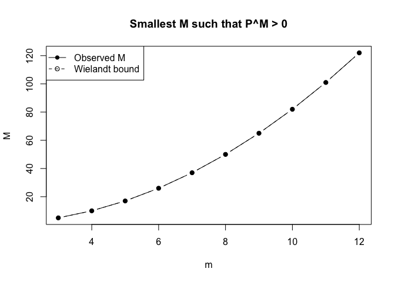
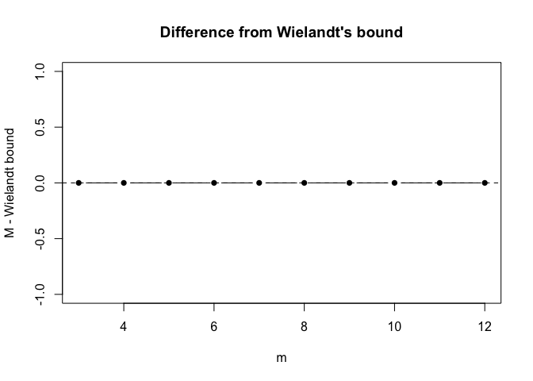
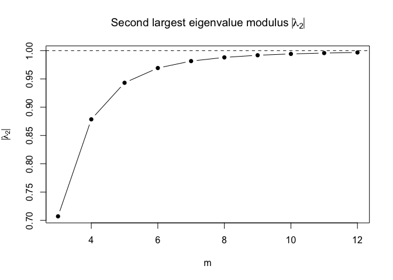
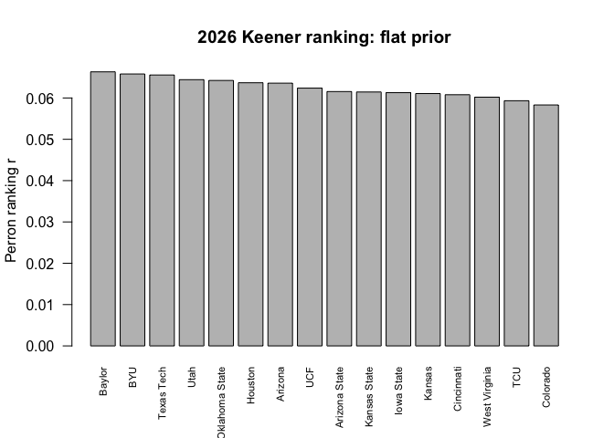
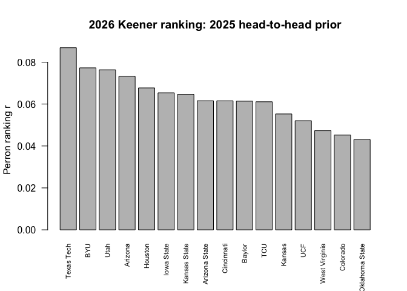
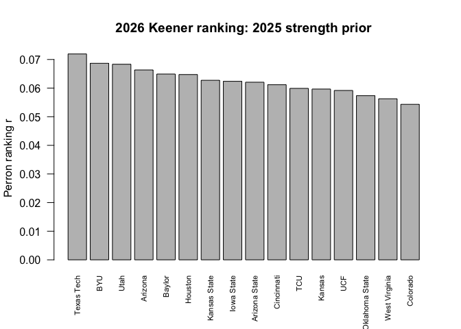
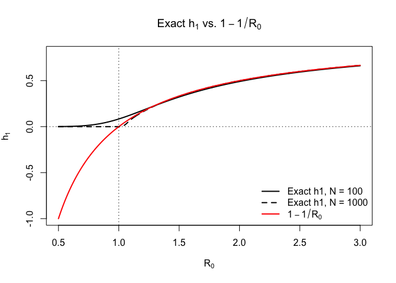

# HW6


## Problem 1 (c)

``` r
make_P <- function(m) {
  P <- matrix(0, nrow = m, ncol = m)

  # i -> i+1 with probability 1 for i < m
  for (i in 1:(m - 1)) {
    P[i, i + 1] <- 1
  }

  # m -> 1 or 2 with probability 1/2 each
  P[m, 1] <- 0.5
  P[m, 2] <- 0.5

  P
}


# Find the smallest M such that P^M > 0 entrywise
# B <- (B %*% P > 0)
find_M <- function(P) {
  m <- nrow(P)

  # Start with P^1
  B <- P > 0
  M <- 1

  while (!all(B)) {
    B <- (B %*% P) > 0
    M <- M + 1
  }

  M
}


# Second-largest eigenvalue modulus
find_lambda2 <- function(P) {
  eig <- eigen(P, only.values = TRUE)$values

  # Sort by modulus, largest first
  mods <- sort(Mod(eig), decreasing = TRUE)

  # Largest is lambda_1 = 1
  mods[2]
}


# Run for m = 3,...,12
results <- data.frame(
  m = 3:12,
  M = NA,
  Wielandt_bound = NA,
  lambda2_modulus = NA
)

for (i in seq_along(results$m)) {

  m <- results$m[i]
  P <- make_P(m)

  results$M[i] <- find_M(P)

  results$Wielandt_bound[i] <- (m - 1)^2 + 1

  results$lambda2_modulus[i] <- find_lambda2(P)
}

print(results)
```

        m   M Wielandt_bound lambda2_modulus
    1   3   5              5       0.7071068
    2   4  10             10       0.8785468
    3   5  17             17       0.9431222
    4   6  26             26       0.9691929
    5   7  37             37       0.9814965
    6   8  50             50       0.9880294
    7   9  65             65       0.9918137
    8  10  82             82       0.9941558
    9  11 101            101       0.9956825
    10 12 122            122       0.9967201

``` r
plot(
  results$m,
  results$M,
  type = "b",
  pch = 16,
  xlab = "m",
  ylab = "M",
  main = "Smallest M such that P^M > 0"
)

lines(
  results$m,
  results$Wielandt_bound,
  type = "b",
  pch = 1,
  lty = 2
)

legend(
  "topleft",
  legend = c("Observed M", "Wielandt bound"),
  pch = c(16, 1),
  lty = c(1, 2)
)
```



``` r
results$difference <- results$M - results$Wielandt_bound

plot(
  results$m,
  results$difference,
  type = "b",
  pch = 16,
  xlab = "m",
  ylab = "M - Wielandt bound",
  main = "Difference from Wielandt's bound"
)

abline(h = 0, lty = 2)
```



``` r
plot(
  results$m,
  results$lambda2_modulus,
  type = "b",
  pch = 16,
  xlab = "m",
  ylab = expression(abs(lambda[2])),
  main = expression(paste("Second largest eigenvalue modulus ", abs(lambda[2])))
)

abline(h = 1, lty = 2)
```



## Problem 2 (c)

``` r
# Read data --------------------------------------------------

games <- read.csv("big12.csv", stringsAsFactors = FALSE)

str(games)
```

    'data.frame':   146 obs. of  9 variables:
     $ season   : int  2025 2025 2025 2025 2025 2025 2025 2025 2025 2025 ...
     $ week     : int  1 3 3 4 4 4 5 5 5 5 ...
     $ date     : chr  "2025-08-23" "2025-09-12" "2025-09-13" "2025-09-20" ...
     $ home     : chr  "Kansas State" "Houston" "Arizona" "Utah" ...
     $ home_pts : num  21 36 23 10 41 24 27 39 21 34 ...
     $ away     : chr  "Iowa State" "Colorado" "Kansas State" "Texas Tech" ...
     $ away_pts : num  24 20 17 34 10 27 24 14 24 37 ...
     $ neutral  : int  1 0 0 0 0 0 0 0 0 0 ...
     $ completed: int  1 1 1 1 1 1 1 1 1 1 ...

``` r
head(games)
```

      season week       date         home home_pts          away away_pts neutral
    1   2025    1 2025-08-23 Kansas State       21    Iowa State       24       1
    2   2025    3 2025-09-12      Houston       36      Colorado       20       0
    3   2025    3 2025-09-13      Arizona       23  Kansas State       17       0
    4   2025    4 2025-09-20         Utah       10    Texas Tech       34       0
    5   2025    4 2025-09-20       Kansas       41 West Virginia       10       0
    6   2025    4 2025-09-20       Baylor       24 Arizona State       27       0
      completed
    1         1
    2         1
    3         1
    4         1
    5         1
    6         1

``` r
# Convert completed to numeric just in case
games$completed <- as.integer(games$completed)

# All teams appearing in the file
teams <- sort(unique(c(games$home, games$away)))
m <- length(teams)

m
```

    [1] 16

``` r
teams
```

     [1] "Arizona"        "Arizona State"  "Baylor"         "BYU"           
     [5] "Cincinnati"     "Colorado"       "Houston"        "Iowa State"    
     [9] "Kansas"         "Kansas State"   "Oklahoma State" "TCU"           
    [13] "Texas Tech"     "UCF"            "Utah"           "West Virginia" 

``` r
# Problem says m = 16
stopifnot(m == 16)
h_fun <- function(x) {
  1/2 + 1/2 * sign(x - 1/2) * sqrt(abs(2 * x - 1))
}


# For a game where team i scores S and team j scores T,
# compute h_ij
game_h <- function(S, T) {

  x <- (S + 1) / (S + T + 2)

  h_fun(x)
}


g2025 <- subset(
  games,
  season == 2025 & completed == 1
)

g2026 <- subset(
  games,
  season == 2026 & completed == 1
)


# a_ij = [sum h_ij over games between i and j + w * Pi_ij]/[n_i + w(m - 1)]

build_A <- function(game_data, teams, prior, w = 1) {

  m <- length(teams)

  A <- matrix(
    0,
    nrow = m,
    ncol = m,
    dimnames = list(teams, teams)
  )

  # n_i = number of completed games played by team i
  n_games <- setNames(rep(0, m), teams)

  # Sum of observed h_ij values
  Hsum <- matrix(
    0,
    nrow = m,
    ncol = m,
    dimnames = list(teams, teams)
  )

  # Loop over completed games
  for (g in seq_len(nrow(game_data))) {

    home <- game_data$home[g]
    away <- game_data$away[g]

    S_home <- game_data$home_pts[g]
    S_away <- game_data$away_pts[g]

    # h value from each team's perspective
    h_home <- game_h(S_home, S_away)
    h_away <- game_h(S_away, S_home)

    Hsum[home, away] <- Hsum[home, away] + h_home
    Hsum[away, home] <- Hsum[away, home] + h_away

    n_games[home] <- n_games[home] + 1
    n_games[away] <- n_games[away] + 1
  }

  # Construct A
  for (i in seq_len(m)) {

    team_i <- teams[i]

    denom <- n_games[team_i] + w * (m - 1)

    for (j in seq_len(m)) {

      if (i == j) {

        A[i, j] <- 0

      } else {

        A[i, j] <-
          (Hsum[i, j] + w * prior[i, j]) / denom
      }
    }
  }

  A
}


get_perron <- function(A) {

  eig <- eigen(A)

  # Perron eigenvalue = eigenvalue with largest modulus
  idx <- which.max(Mod(eig$values))

  lambda_star <- Re(eig$values[idx])

  # Corresponding eigenvector
  r <- Re(eig$vectors[, idx])

  # Eigenvectors can come back with opposite sign
  if (sum(r) < 0) {
    r <- -r
  }

  # Normalize so rankings sum to 1
  r <- r / sum(r)

  names(r) <- rownames(A)

  # Second largest eigenvalue modulus
  eig_mod <- sort(Mod(eig$values), decreasing = TRUE)

  lambda2_mod <- eig_mod[2]

  ratio <- lambda2_mod / abs(lambda_star)

  list(
    r = r,
    lambda_star = lambda_star,
    lambda2_mod = lambda2_mod,
    ratio = ratio,
    eigenvalues = eig$values
  )
}
```

Try different prior

``` r
# ============================================================
# PRIOR 1: Flat prior
#
# Pi_ij = 1/2 for all i != j
# ============================================================

prior_flat <- matrix(
  0.5,
  nrow = m,
  ncol = m,
  dimnames = list(teams, teams)
)

diag(prior_flat) <- 0


# ============================================================
# PRIOR 2: Last-season head-to-head prior
#
# Pi_ij = mean h_ij over 2025 meetings
# If teams did not meet, use 1/2
# ============================================================

prior_last <- matrix(
  0.5,
  nrow = m,
  ncol = m,
  dimnames = list(teams, teams)
)

diag(prior_last) <- 0


for (i in seq_len(m)) {

  for (j in seq_len(m)) {

    if (i == j) next

    team_i <- teams[i]
    team_j <- teams[j]

    # 2025 games involving i and j
    pair_games <- g2025[
      (g2025$home == team_i & g2025$away == team_j) |
      (g2025$home == team_j & g2025$away == team_i),
    ]

    if (nrow(pair_games) > 0) {

      h_values <- numeric(nrow(pair_games))

      for (g in seq_len(nrow(pair_games))) {

        if (pair_games$home[g] == team_i) {

          S_i <- pair_games$home_pts[g]
          S_j <- pair_games$away_pts[g]

        } else {

          S_i <- pair_games$away_pts[g]
          S_j <- pair_games$home_pts[g]
        }

        h_values[g] <- game_h(S_i, S_j)
      }

      prior_last[i, j] <- mean(h_values)
    }
  }
}


# Check required symmetry:
# Pi_ij + Pi_ji should be 1
max(abs(prior_last + t(prior_last) -
          (matrix(1, m, m) - diag(m))))
```

    [1] 1.110223e-16

``` r
# ============================================================
# PRIOR 3: 2025 overall team-strength prior
#
# First estimate 2025 Keener strengths using a flat prior.
# Then define
#
# Pi_ij = s_i / (s_i + s_j)
# ============================================================

A_2025 <- build_A(
  game_data = g2025,
  teams = teams,
  prior = prior_flat,
  w = 1
)

fit_2025 <- get_perron(A_2025)

strength_2025 <- fit_2025$r

strength_2025
```

           Arizona  Arizona State         Baylor            BYU     Cincinnati 
        0.06813731     0.06343402     0.05951305     0.06799203     0.06260959 
          Colorado        Houston     Iowa State         Kansas   Kansas State 
        0.05367311     0.06431347     0.06483744     0.05911981     0.06476108 
    Oklahoma State            TCU     Texas Tech            UCF           Utah 
        0.04961680     0.06333951     0.07887035     0.05508294     0.07056306 
     West Virginia 
        0.05413640 

``` r
prior_strength <- matrix(
  0,
  nrow = m,
  ncol = m,
  dimnames = list(teams, teams)
)

for (i in seq_len(m)) {

  for (j in seq_len(m)) {

    if (i == j) {

      prior_strength[i, j] <- 0

    } else {

      prior_strength[i, j] <-
        strength_2025[i] /
        (strength_2025[i] + strength_2025[j])
    }
  }
}


# Check Pi_ij + Pi_ji = 1
max(abs(prior_strength + t(prior_strength) -
          (matrix(1, m, m) - diag(m))))
```

    [1] 2.220446e-16

``` r
w <- 1

A_flat <- build_A(
  g2026,
  teams,
  prior_flat,
  w
)

A_last <- build_A(
  g2026,
  teams,
  prior_last,
  w
)

A_strength <- build_A(
  g2026,
  teams,
  prior_strength,
  w
)


fit_flat <- get_perron(A_flat)
fit_last <- get_perron(A_last)
fit_strength <- get_perron(A_strength)
```

``` r
# lambda*, |lambda_2| / lambda*

summary_results <- data.frame(
  prior = c(
    "Flat",
    "2025 head-to-head",
    "2025 overall strength"
  ),
  lambda_star = c(
    fit_flat$lambda_star,
    fit_last$lambda_star,
    fit_strength$lambda_star
  ),
  lambda2_mod = c(
    fit_flat$lambda2_mod,
    fit_last$lambda2_mod,
    fit_strength$lambda2_mod
  ),
  lambda2_ratio = c(
    fit_flat$ratio,
    fit_last$ratio,
    fit_strength$ratio
  )
)

print(summary_results)
```

                      prior lambda_star lambda2_mod lambda2_ratio
    1                  Flat   0.4992328  0.07937040     0.1589847
    2     2025 head-to-head   0.4818751  0.07707555     0.1599492
    3 2025 overall strength   0.4970334  0.07927495     0.1594962

``` r
rankings <- data.frame(
  team = teams,
  flat = fit_flat$r[teams],
  last_season = fit_last$r[teams],
  strength_prior = fit_strength$r[teams]
)

# Add rank numbers: 1 = strongest
rankings$rank_flat <-
  rank(-rankings$flat, ties.method = "min")

rankings$rank_last <-
  rank(-rankings$last_season, ties.method = "min")

rankings$rank_strength <-
  rank(-rankings$strength_prior, ties.method = "min")


# Sort according to flat ranking just for display
rankings <- rankings[
  order(rankings$rank_flat),
]

print(rankings)
```

                             team       flat last_season strength_prior rank_flat
    Baylor                 Baylor 0.06632590  0.06138043     0.06491839         1
    BYU                       BYU 0.06580838  0.07727968     0.06867076         2
    Texas Tech         Texas Tech 0.06556100  0.08688297     0.07193071         3
    Utah                     Utah 0.06442941  0.07635256     0.06833457         4
    Oklahoma State Oklahoma State 0.06424067  0.04306694     0.05734966         5
    Houston               Houston 0.06368354  0.06771082     0.06473909         6
    Arizona               Arizona 0.06358782  0.07320319     0.06634591         7
    UCF                       UCF 0.06238453  0.05207087     0.05917812         8
    Arizona State   Arizona State 0.06155530  0.06158312     0.06205824         9
    Kansas State     Kansas State 0.06144694  0.06463858     0.06273217        10
    Iowa State         Iowa State 0.06128779  0.06537928     0.06237704        11
    Kansas                 Kansas 0.06107168  0.05528689     0.05967013        12
    Cincinnati         Cincinnati 0.06078449  0.06156223     0.06117906        13
    West Virginia   West Virginia 0.06019373  0.04729384     0.05627776        14
    TCU                       TCU 0.05933335  0.06110296     0.05990657        15
    Colorado             Colorado 0.05830549  0.04520564     0.05433181        16
                   rank_last rank_strength
    Baylor                10             5
    BYU                    2             2
    Texas Tech             1             1
    Utah                   3             3
    Oklahoma State        16            14
    Houston                5             6
    Arizona                4             4
    UCF                   13            13
    Arizona State          8             9
    Kansas State           7             7
    Iowa State             6             8
    Kansas                12            12
    Cincinnati             9            10
    West Virginia         14            15
    TCU                   11            11
    Colorado              15            16

``` r
# ----- Flat prior -----

tmp <- rankings[
  order(rankings$flat, decreasing = TRUE),
]

barplot(
  tmp$flat,
  names.arg = tmp$team,
  las = 2,
  cex.names = 0.7,
  ylab = "Perron ranking r",
  main = "2026 Keener ranking: flat prior"
)
```



``` r
# ----- Last-season prior -----

tmp <- rankings[
  order(rankings$last_season, decreasing = TRUE),
]

barplot(
  tmp$last_season,
  names.arg = tmp$team,
  las = 2,
  cex.names = 0.7,
  ylab = "Perron ranking r",
  main = "2026 Keener ranking: 2025 head-to-head prior"
)
```



``` r
# ----- Overall 2025 strength prior -----

tmp <- rankings[
  order(rankings$strength_prior, decreasing = TRUE),
]

barplot(
  tmp$strength_prior,
  names.arg = tmp$team,
  las = 2,
  cex.names = 0.7,
  ylab = "Perron ranking r",
  main = "2026 Keener ranking: 2025 strength prior"
)
```



Predict games

``` r
future_games <- subset(
  games,
  season == 2026 & completed == 0
)

future_games[
  order(future_games$week),
  c("week", "home", "away")
]
```

        week           home           away
    89     6            BYU     Iowa State
    90     6 Oklahoma State            UCF
    91     6  West Virginia        Arizona
    92     6   Kansas State        Houston
    93     6           Utah         Kansas
    94     7       Colorado           Utah
    95     7  West Virginia     Cincinnati
    96     7   Kansas State         Kansas
    97     7     Texas Tech  Arizona State
    98     7         Baylor            TCU
    99     7        Houston Oklahoma State
    100    8            UCF            BYU
    101    8     Cincinnati     Texas Tech
    102    8           Utah        Houston
    103    8 Oklahoma State       Colorado
    104    8         Kansas         Baylor
    105    8        Arizona     Iowa State
    106    8  Arizona State   Kansas State
    107    8            TCU  West Virginia
    108    9            UCF         Baylor
    109    9            BYU  Arizona State
    110    9     Texas Tech        Arizona
    111    9     Cincinnati           Utah
    112    9     Iowa State Oklahoma State
    113    9            TCU         Kansas
    114    9       Colorado   Kansas State
    115   10        Arizona            TCU
    116   10           Utah            BYU
    117   10     Texas Tech  West Virginia
    118   10   Kansas State Oklahoma State
    119   10        Houston     Cincinnati
    120   10         Kansas            UCF
    121   10  Arizona State       Colorado
    122   10         Baylor     Iowa State
    123   11       Colorado        Houston
    124   11            BYU         Baylor
    125   11 Oklahoma State     Texas Tech
    126   11        Arizona           Utah
    127   11            UCF  Arizona State
    128   11     Iowa State     Cincinnati
    129   11  West Virginia         Kansas
    130   11            TCU   Kansas State
    131   12            UCF     Iowa State
    132   12         Kansas            BYU
    133   12         Baylor     Texas Tech
    134   12            TCU           Utah
    135   12  Arizona State Oklahoma State
    136   12  West Virginia        Houston
    137   12   Kansas State        Arizona
    138   12     Cincinnati       Colorado
    139   13     Texas Tech            TCU
    140   13           Utah  West Virginia
    141   13            BYU     Cincinnati
    142   13 Oklahoma State         Kansas
    143   13        Houston         Baylor
    144   13        Arizona  Arizona State
    145   13       Colorado            UCF
    146   13     Iowa State   Kansas State

``` r
# See which weeks remain
sort(unique(future_games$week))
```

    [1]  6  7  8  9 10 11 12 13

``` r
TARGET_WEEK <- 6  
target_games <- subset(
  games,
  season == 2026 &
    completed == 0 &
    week == TARGET_WEEK
)

target_games[, c("week", "home", "away")]
```

       week           home       away
    89    6            BYU Iowa State
    90    6 Oklahoma State        UCF
    91    6  West Virginia    Arizona
    92    6   Kansas State    Houston
    93    6           Utah     Kansas

``` r
predict_games <- function(game_data, r) {

  result <- data.frame(
    home = game_data$home,
    away = game_data$away,
    home_r = r[game_data$home],
    away_r = r[game_data$away],
    predicted_winner = NA_character_
  )

  result$predicted_winner <- ifelse(
    result$home_r > result$away_r,
    result$home,
    result$away
  )

  rownames(result) <- NULL

  result
}


pred_flat <- predict_games(
  target_games,
  fit_flat$r
)

pred_last <- predict_games(
  target_games,
  fit_last$r
)

pred_strength <- predict_games(
  target_games,
  fit_strength$r
)


pred_flat
```

                home       away     home_r     away_r predicted_winner
    1            BYU Iowa State 0.06580838 0.06128779              BYU
    2 Oklahoma State        UCF 0.06424067 0.06238453   Oklahoma State
    3  West Virginia    Arizona 0.06019373 0.06358782          Arizona
    4   Kansas State    Houston 0.06144694 0.06368354          Houston
    5           Utah     Kansas 0.06442941 0.06107168             Utah

``` r
pred_last
```

                home       away     home_r     away_r predicted_winner
    1            BYU Iowa State 0.07727968 0.06537928              BYU
    2 Oklahoma State        UCF 0.04306694 0.05207087              UCF
    3  West Virginia    Arizona 0.04729384 0.07320319          Arizona
    4   Kansas State    Houston 0.06463858 0.06771082          Houston
    5           Utah     Kansas 0.07635256 0.05528689             Utah

``` r
pred_strength
```

                home       away     home_r     away_r predicted_winner
    1            BYU Iowa State 0.06867076 0.06237704              BYU
    2 Oklahoma State        UCF 0.05734966 0.05917812              UCF
    3  West Virginia    Arizona 0.05627776 0.06634591          Arizona
    4   Kansas State    Houston 0.06273217 0.06473909          Houston
    5           Utah     Kansas 0.06833457 0.05967013             Utah

``` r
predictions <- data.frame(
  home = target_games$home,
  away = target_games$away,
  flat = pred_flat$predicted_winner,
  last_season = pred_last$predicted_winner,
  strength_prior = pred_strength$predicted_winner
)

print(predictions)
```

                home       away           flat last_season strength_prior
    1            BYU Iowa State            BYU         BYU            BYU
    2 Oklahoma State        UCF Oklahoma State         UCF            UCF
    3  West Virginia    Arizona        Arizona     Arizona        Arizona
    4   Kansas State    Houston        Houston     Houston        Houston
    5           Utah     Kansas           Utah        Utah           Utah

``` r
majority_vote <- function(x) {

  tab <- table(x)

  names(tab)[which.max(tab)]
}

predictions$consensus <- apply(
  predictions[, c(
    "flat",
    "last_season",
    "strength_prior"
  )],
  1,
  majority_vote
)

print(predictions)
```

                home       away           flat last_season strength_prior consensus
    1            BYU Iowa State            BYU         BYU            BYU       BYU
    2 Oklahoma State        UCF Oklahoma State         UCF            UCF       UCF
    3  West Virginia    Arizona        Arizona     Arizona        Arizona   Arizona
    4   Kansas State    Houston        Houston     Houston        Houston   Houston
    5           Utah     Kansas           Utah        Utah           Utah      Utah

## Problem 3 (c)

``` r
exact_h1 <- function(N, R0) {

  K <- N / 10

  # rho_0 = 1
  rho <- numeric(K)
  rho[1] <- 1

  # rho_j = product_{k=1}^j N / [R0 (N-k)]
  
  # In R indexing:
  # rho[j + 1] corresponds to mathematical rho_j
  if (K > 1) {
    for (j in 1:(K - 1)) {

      rho[j + 1] <-
        rho[j] * N / (R0 * (N - j))
    }
  }

  # For n = 1:
  # h1 = rho_0 / sum_{j=0}^{K-1} rho_j
  #    = 1 / sum(rho)
  h1 <- 1 / sum(rho)

  return(h1)
}


R0_values <- seq(
  from = 0.5,
  to = 3,
  length.out = 500
)


h1_N100 <- sapply(
  R0_values,
  function(r) exact_h1(N = 100, R0 = r)
)

h1_N1000 <- sapply(
  R0_values,
  function(r) exact_h1(N = 1000, R0 = r)
)
```

``` r
# Theoretical curve requested in the question
theory <- 1 - 1 / R0_values


# Plot
plot(
  R0_values,
  h1_N100,
  type = "l",
  lwd = 2,
  ylim = c(min(theory), 0.8),
  xlab = expression(R[0]),
  ylab = expression(h[1]),
  main = expression(
    paste("Exact ", h[1], " vs. ", 1 - 1/R[0])
  )
)

# N = 1000
lines(
  R0_values,
  h1_N1000,
  lwd = 2,
  lty = 2
)

# 1 - 1/R0 in RED
lines(
  R0_values,
  theory,
  col = "red",
  lwd = 2
)

# Reference lines
abline(h = 0, lty = 3)
abline(v = 1, lty = 3)


# Legend
legend(
  "bottomright",
  legend = c(
    "Exact h1, N = 100",
    "Exact h1, N = 1000",
    expression(1 - 1/R[0])
  ),
  lty = c(1, 2, 1),
  lwd = 2,
  col = c("black", "black", "red"),
  bty = "n"
)
```



## Problem 3 (d)

``` r
N <- 100
K <- 10
gamma <- 1
dt <- 0.005

R0_values <- c(0.5, 0.8, 1.5, 3)


expected_hitting_time <- function(R0,
                                  N = 100,
                                  K = 10,
                                  gamma = 1,
                                  dt = 0.005) {

  # R0 = beta * N / gamma
  beta <- R0 * gamma / N

  # Unknowns are e_1,...,e_{K-1}
  A <- matrix(
    0,
    nrow = K - 1,
    ncol = K - 1
  )

  b <- rep(dt, K - 1)

  for (n in 1:(K - 1)) {

    p <- beta * n * (N - n) * dt
    q <- gamma * n * dt

    i <- n

    # coefficient of e_n
    A[i, i] <- p + q

    # coefficient of e_{n-1}
    if (n > 1) {
      A[i, i - 1] <- -q
    }

    # coefficient of e_{n+1}
    if (n < K - 1) {
      A[i, i + 1] <- -p
    }

    # e_0 = e_K = 0, so boundary terms contribute nothing
  }

  e <- solve(A, b)

  names(e) <- paste0("e", 1:(K - 1))

  return(
    list(
      R0 = R0,
      beta = beta,
      e = e,
      e1 = e[1]
    )
  )
}


results <- lapply(
  R0_values,
  expected_hitting_time,
  N = N,
  K = K,
  gamma = gamma,
  dt = dt
)


summary_table <- data.frame(
  R0 = sapply(results, function(x) x$R0),
  beta = sapply(results, function(x) x$beta),
  e1 = sapply(results, function(x) x$e1)
)

print(summary_table)
```

       R0  beta        e1
    1 0.5 0.005 1.3735747
    2 0.8 0.008 1.7698760
    3 1.5 0.015 1.7958525
    4 3.0 0.030 0.9654864
