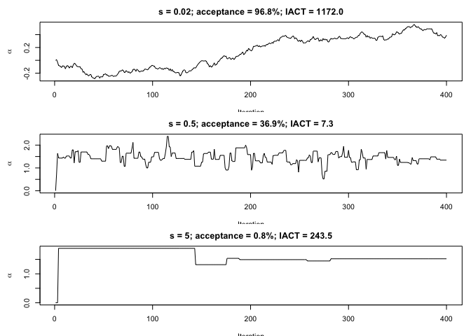
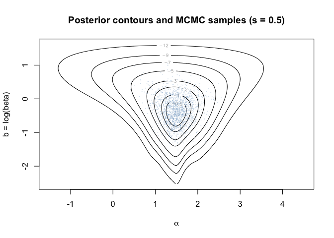
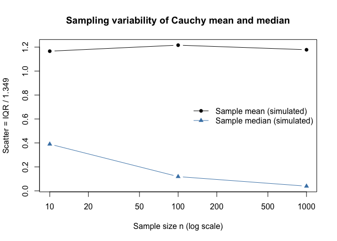
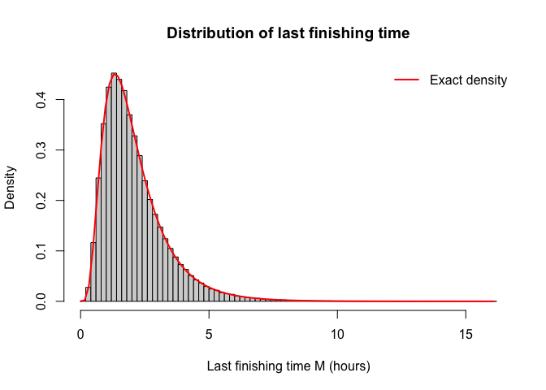
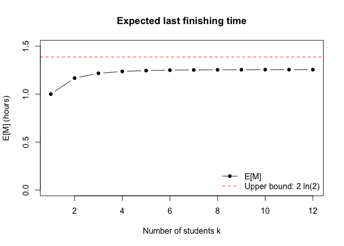
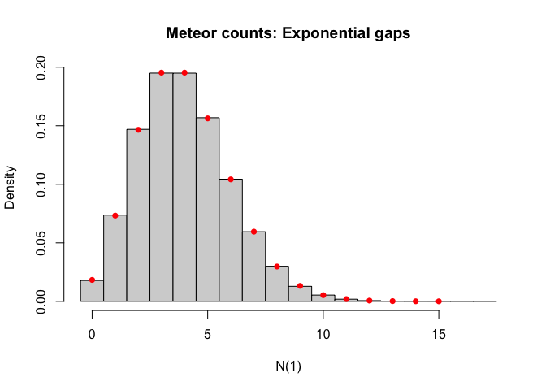
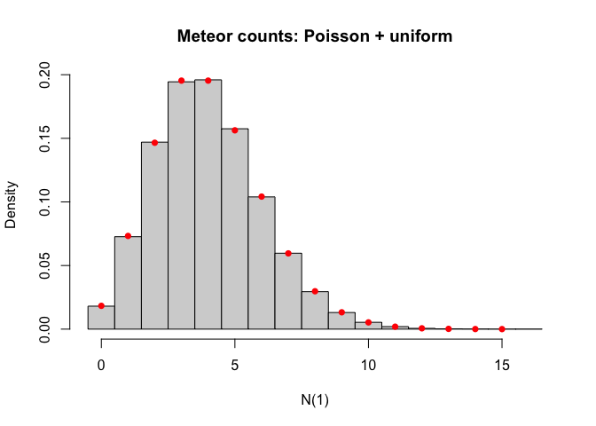
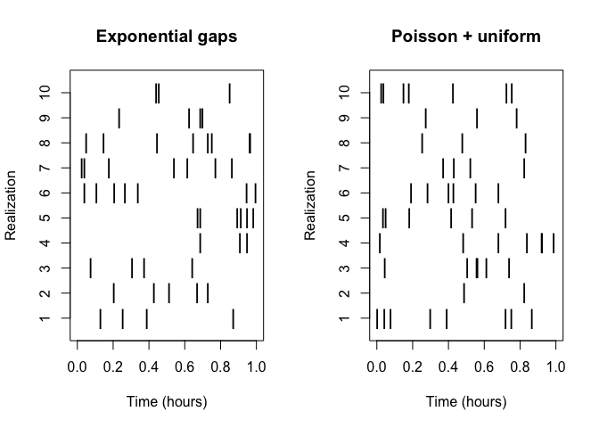
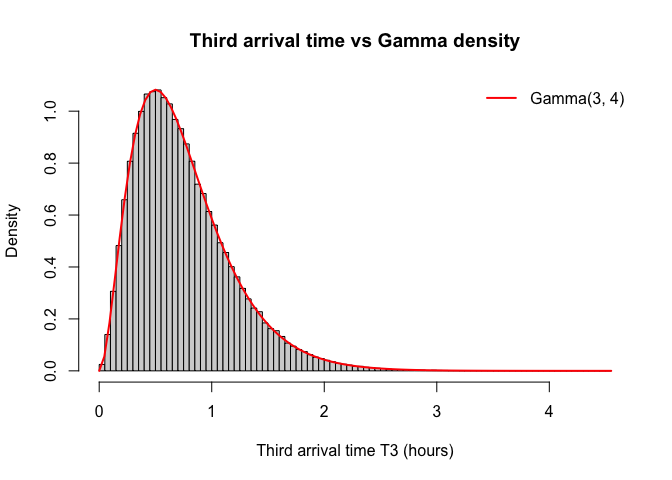
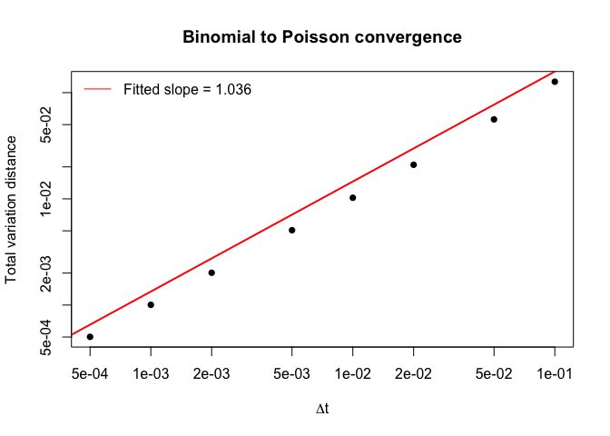

# HW7


## Problem 1 (c)

``` r
set.seed(2026)
x <- c(-1.77, 2.47, 1.34, 2.18, 13.05, 1.60, 1.50, -1.97,
       0.79, 1.50, 2.00, 2.63, 1.19, -2.31, 0.87)
n <- length(x)

log_post <- function(alpha, b, x) {
  n <- length(x)
  n * b - sum(log(exp(2 * b) + (x - alpha)^2))
}

run_mh <- function(step_size, T = 50000L, start = c(0, 0), x) {
  z <- matrix(NA_real_, T, 2L, dimnames = list(NULL, c("alpha", "b")))
  z[1, ] <- start
  current_lp <- log_post(start[1], start[2], x)
  accepted <- 0L
  for (t in 2:T) {
    proposal <- z[t - 1L, ] + rnorm(2L, sd = step_size)
    proposal_lp <- log_post(proposal[1], proposal[2], x)
    if (log(runif(1L)) < proposal_lp - current_lp) {
      z[t, ] <- proposal
      current_lp <- proposal_lp
      accepted <- accepted + 1L
    } else {
      z[t, ] <- z[t - 1L, ]
    }
  }
  list(draws = z, acceptance = accepted / (T - 1L), s = step_size)
}


iact <- function(y) {
  ac <- as.numeric(stats::acf(y, lag.max = min(5000L, length(y) - 1L),
                              plot = FALSE)$acf)[-1L]
  if (length(ac) < 2L) return(NA_real_)
  pair_sums <- ac[seq.int(1L, length(ac) - 1L, by = 2L)] +
    ac[seq.int(2L, length(ac), by = 2L)]
  first_nonpositive <- which(pair_sums <= 0)
  n_keep <- if (length(first_nonpositive)) first_nonpositive[1] - 1L else length(pair_sums)
  1 + 2 * sum(pair_sums[seq_len(n_keep)])
}

step_sizes <- c(0.02, 0.5, 5)
chains <- lapply(step_sizes, run_mh, T = 50000L, x = x)
comparison <- data.frame(
  step_size = step_sizes,
  acceptance_rate = sapply(chains, `[[`, "acceptance"),
  IACT_alpha = sapply(chains, function(chain) iact(chain$draws[, "alpha"]))
)

knitr::kable(comparison, digits = 3)
```

| step_size | acceptance_rate | IACT_alpha |
|----------:|----------------:|-----------:|
|      0.02 |           0.968 |   1172.050 |
|      0.50 |           0.369 |      7.327 |
|      5.00 |           0.008 |    243.528 |

Trace plots: first 400 values of alpha

``` r
par(mfrow = c(3, 1), mar = c(3.5, 4.5, 2.5, 1))
for (i in seq_along(chains)) {
  plot(chains[[i]]$draws[1:400, "alpha"], type = "l",
       xlab = "Iteration", ylab = expression(alpha),
       main = sprintf("s = %g; acceptance = %.1f%%; IACT = %.1f",
                      step_sizes[i], 100 * comparison$acceptance_rate[i],
                      comparison$IACT_alpha[i]))
}
```



``` r
par(mfrow = c(1, 1))
```

The very small step size accepts almost all proposals but travels
slowly; the very large step size frequently rejects proposals and stays
in place.

We select the step size with the lowest estimated IACT.

Best chain, after 5,000 burn-in steps

``` r
best_index <- which.min(comparison$IACT_alpha)
best_s <- step_sizes[best_index]
burn_in <- 5000L
post_draws <- chains[[best_index]]$draws[-seq_len(burn_in), , drop = FALSE]
post_alpha <- post_draws[, "alpha"]
post_beta <- exp(post_draws[, "b"])
cat("Best step size:", best_s, "\n")
```

    Best step size: 0.5 

Exact posterior approximated on a fine grid

``` r
alpha_grid <- seq(-1.5, 4.5, length.out = 501)
b_grid <- seq(log(0.08), log(5), length.out = 451)
log_grid <- outer(alpha_grid, b_grid,
                  Vectorize(function(a, b) log_post(a, b, x)))
relative_grid <- exp(log_grid - max(log_grid))
weights <- relative_grid / sum(relative_grid)

# Contour plot, with thinned post-burn-in samples overlaid.
contour(alpha_grid, b_grid, log_grid - max(log_grid),
        levels = c(-12, -9, -7, -5, -3, -2, -1, -0.5),
        xlab = expression(alpha), ylab = "b = log(beta)",
        main = sprintf("Posterior contours and MCMC samples (s = %g)", best_s))
set.seed(2027)
thinned_ids <- seq(1, nrow(post_draws), by = 30)
points(post_draws[thinned_ids, "alpha"], post_draws[thinned_ids, "b"],
       pch = 16, cex = 0.25, col = adjustcolor("steelblue", alpha.f = 0.25))
```



Posterior summaries from MCMC and grid

``` r
weighted_quantile <- function(values, weights, probs = c(0.05, 0.95)) {
  ord <- order(values)
  values <- values[ord]
  weights <- weights[ord] / sum(weights)
  vapply(probs, function(p) values[which(cumsum(weights) >= p)[1]], numeric(1))
}

alpha_weights <- rowSums(weights)
b_weights <- colSums(weights)
beta_grid <- exp(b_grid)

summarize_draws <- function(v) c(mean = mean(v), lower_5 = unname(quantile(v, 0.05)),
                                 upper_95 = unname(quantile(v, 0.95)))
summarize_grid <- function(v, w) c(mean = sum(v * w),
                                    lower_5 = weighted_quantile(v, w)[1],
                                    upper_95 = weighted_quantile(v, w)[2])

posterior_summary <- rbind(
  "alpha: MCMC" = summarize_draws(post_alpha),
  "alpha: grid" = summarize_grid(alpha_grid, alpha_weights),
  "beta: MCMC" = summarize_draws(post_beta),
  "beta: grid" = summarize_grid(beta_grid, b_weights)
)
knitr::kable(posterior_summary, digits = 4)
```

|             |   mean | lower_5 | upper_95 |
|:------------|-------:|--------:|---------:|
| alpha: MCMC | 1.4852 |  1.0218 |   1.9409 |
| alpha: grid | 1.4827 |  1.0320 |   1.9320 |
| beta: MCMC  | 0.7801 |  0.3730 |   1.4171 |
| beta: grid  | 0.7755 |  0.3746 |   1.3812 |

``` r
cat(sprintf("Sample mean of x: %.4f\nSample median of x: %.4f\n",
            mean(x), median(x)))
```

    Sample mean of x: 1.6713
    Sample median of x: 1.5000

## Problem 1 (d)

``` r
set.seed(2028)
ns <- c(10L, 100L, 1000L)
B <- 2000L
location <- 1.5
scale <- 0.8

sim_results <- lapply(ns, function(n) {
  X <- matrix(rcauchy(B * n, location = location, scale = scale),
              nrow = B, ncol = n)
  data.frame(n = n, dataset = seq_len(B),
             sample_mean = rowMeans(X),
             sample_median = apply(X, 1L, median))
})
sim_results <- do.call(rbind, sim_results)

scatter <- function(y) IQR(y) / 1.349
scatter_table <- do.call(rbind, lapply(ns, function(n) {
  z <- sim_results[sim_results$n == n, ]
  data.frame(
    n = n,
    `scatter of mean` = scatter(z$sample_mean),
    `scatter of median` = scatter(z$sample_median),
    check.names = FALSE
  )
}))

knitr::kable(scatter_table, digits = 4)
```

|    n | scatter of mean | scatter of median |
|-----:|----------------:|------------------:|
|   10 |          1.1661 |            0.3899 |
|  100 |          1.2164 |            0.1188 |
| 1000 |          1.1781 |            0.0388 |

Comparison plot

``` r
plot(ns, scatter_table$`scatter of mean`,
     type = "b", log = "x", pch = 16,
     ylim = range(c(scatter_table$`scatter of mean`,
                    scatter_table$`scatter of median`,
                    2 * scale / 1.349)),
     xlab = "Sample size n (log scale)",
     ylab = "Scatter = IQR / 1.349",
     main = "Sampling variability of Cauchy mean and median")

lines(ns, scatter_table$`scatter of median`,
      type = "b", pch = 17, col = "steelblue")


legend("right",
       legend = c("Sample mean (simulated)",
                  "Sample median (simulated)"),
       col = c("black", "steelblue", "black"),
       lty = c(1, 1, 2),
       pch = c(16, 17, NA),
       bty = "n")
```



## Problem 2 (d)

``` r
rates <- c(3, 2, 1.5, 1.2, 1, 0.75)
n <- length(rates)

subset_dp <- function(rates) {
  n <- length(rates)
  N <- 2^n

  # Expected remaining time for each subset
  V <- numeric(N)

  # Probability of each student finishing last
  last_prob <- matrix(0, nrow = N, ncol = n)

  # Binary representation of subsets
  for (mask in 1:(N - 1)) {

    S <- which(sapply(1:n, function(i)
      bitwAnd(mask, bitwShiftL(1L, i - 1L)) != 0))

    total <- sum(rates[S])

    # Expected time until the next student finishes
    V[mask + 1] <- 1 / total

    if (length(S) == 1) {
      last_prob[mask + 1, S] <- 1
    } else {
      for (i in S) {

        # Remove student i
        next_mask <- mask - 2^(i - 1)
        p <- rates[i] / total

        V[mask + 1] <- V[mask + 1] +
          p * V[next_mask + 1]

        last_prob[mask + 1, ] <-
          last_prob[mask + 1, ] +
          p * last_prob[next_mask + 1, ]
      }
    }
  }

  list(
    mean_M = V[N],
    last_prob = last_prob[N, ]
  )
}

exact <- subset_dp(rates)

cat("Exact E[M]:", exact$mean_M, "\n")
```

    Exact E[M]: 2.107376 

``` r
data.frame(
  student = 1:n,
  rate = rates,
  prob_last = exact$last_prob
)
```

      student rate  prob_last
    1       1 3.00 0.02678555
    2       2 2.00 0.06953194
    3       3 1.50 0.12298798
    4       4 1.20 0.18125242
    5       5 1.00 0.24098349
    6       6 0.75 0.35845862

``` r
mean_alternating <- function(rates) {
  n <- length(rates)
  ans <- 0

  for (k in 1:n) {
    groups <- combn(1:n, k, simplify = FALSE)

    for (S in groups) {
      ans <- ans + (-1)^(k + 1) / sum(rates[S])
    }
  }

  ans
}

E_alternating <- mean_alternating(rates)

data.frame(
  method = c("Dynamic programming", "Alternating formula"),
  E_M = c(exact$mean_M, E_alternating)
)
```

                   method      E_M
    1 Dynamic programming 2.107376
    2 Alternating formula 2.107376

``` r
set.seed(123)
B <- 200000

# Each column represents one student
X <- sapply(rates, function(lambda) rexp(B, rate = lambda))

# Last finishing time and student
M <- apply(X, 1, max)
last_student <- max.col(X, ties.method = "first")

# Compare exact and simulated results
comparison <- data.frame(
  student = 1:n,
  rate = rates,
  exact_prob_last = exact$last_prob,
  simulated_prob_last = tabulate(last_student, nbins = n) / B
)

knitr::kable(comparison, digits = 4)
```

| student | rate | exact_prob_last | simulated_prob_last |
|--------:|-----:|----------------:|--------------------:|
|       1 | 3.00 |          0.0268 |              0.0272 |
|       2 | 2.00 |          0.0695 |              0.0695 |
|       3 | 1.50 |          0.1230 |              0.1242 |
|       4 | 1.20 |          0.1813 |              0.1806 |
|       5 | 1.00 |          0.2410 |              0.2417 |
|       6 | 0.75 |          0.3585 |              0.3567 |

``` r
data.frame(
  method = c("Exact", "Simulation"),
  E_M = c(exact$mean_M, mean(M))
)
```

          method      E_M
    1      Exact 2.107376
    2 Simulation 2.104703

``` r
density_M <- function(t, rates) {
  sapply(t, function(tt) {
    sum(sapply(seq_along(rates), function(i) {
      rates[i] * exp(-rates[i] * tt) *
        prod(1 - exp(-rates[-i] * tt))
    }))
  })
}

hist(M, breaks = 70, probability = TRUE,
     xlab = "Last finishing time M (hours)",
     main = "Distribution of last finishing time")

curve(density_M(x, rates),
      from = 0, to = max(M),
      add = TRUE, col = "red", lwd = 2)

legend("topright", legend = "Exact density",
       col = "red", lwd = 2, bty = "n")
```



``` r
first_time <- apply(X, 1, min)
first_student <- max.col(-X, ties.method = "first")

first_check <- data.frame(
  student = 1:n,
  theoretical_prob_first = rates / sum(rates),
  simulated_prob_first =
    tabulate(first_student, nbins = n) / B,
  conditional_mean_time = sapply(1:n, function(i) {
    mean(first_time[first_student == i])
  })
)

knitr::kable(first_check, digits = 4)
```

| student | theoretical_prob_first | simulated_prob_first | conditional_mean_time |
|--------:|-----------------------:|---------------------:|----------------------:|
|       1 |                 0.3175 |               0.3193 |                0.1063 |
|       2 |                 0.2116 |               0.2115 |                0.1060 |
|       3 |                 0.1587 |               0.1578 |                0.1056 |
|       4 |                 0.1270 |               0.1265 |                0.1058 |
|       5 |                 0.1058 |               0.1058 |                0.1053 |
|       6 |                 0.0794 |               0.0790 |                0.1049 |

``` r
ks <- 1:12

mean_M <- sapply(ks, function(k) {
  subset_dp(1:k)$mean_M
})

knitr::kable(
  data.frame(k = ks, E_M = mean_M),
  digits = 4
)
```

|   k |    E_M |
|----:|-------:|
|   1 | 1.0000 |
|   2 | 1.1667 |
|   3 | 1.2167 |
|   4 | 1.2361 |
|   5 | 1.2449 |
|   6 | 1.2493 |
|   7 | 1.2517 |
|   8 | 1.2530 |
|   9 | 1.2538 |
|  10 | 1.2543 |
|  11 | 1.2546 |
|  12 | 1.2548 |

``` r
plot(ks, mean_M, type = "b", pch = 16,
     ylim = c(0, 1.5),
     xlab = "Number of students k",
     ylab = "E[M] (hours)",
     main = "Expected last finishing time")

abline(h = 2 * log(2), col = "red", lty = 2)

legend("bottomright",
       legend = c("E[M]", "Upper bound: 2 ln(2)"),
       col = c("black", "red"),
       lty = c(1, 2), pch = c(16, NA),
       bty = "n")
```



## Problem 3 (d)

``` r
set.seed(123)

lambda <- 4
B <- 200000
t_end <- 1

# Method 1: Exponential interarrival times
simulate_gaps <- function(B, lambda, t_end = 1) {
  counts <- integer(B)
  counts_half <- integer(B)
  first_time <- rep(NA_real_, B)

  # First arrival in each realization
  arrival <- rexp(B, rate = lambda)
  first_time <- arrival

  # Continue generating arrivals until t_end
  active <- which(arrival <= t_end)

  while (length(active) > 0) {
    counts[active] <- counts[active] + 1L
    counts_half[active] <- counts_half[active] +
      as.integer(arrival[active] <= t_end / 2)

    arrival[active] <- arrival[active] +
      rexp(length(active), rate = lambda)

    active <- active[arrival[active] <= t_end]
  }

  list(
    counts = counts,
    counts_half = counts_half,
    first_time = first_time
  )
}

gaps <- simulate_gaps(B, lambda)

# Method 2: Poisson counts + uniform locations
counts_u <- rpois(B, lambda * t_end)
counts_half_u <- integer(B)
first_time_u <- rep(NA_real_, B)

for (j in seq_len(B)) {
  if (counts_u[j] > 0) {
    times <- runif(counts_u[j], 0, t_end)
    counts_half_u[j] <- sum(times <= t_end / 2)
    first_time_u[j] <- min(times)
  }
}
```

Compare N(1) with Poisson(4)

``` r
count_table <- data.frame(
  N = 0:15,
  exponential_gaps = tabulate(
    gaps$counts + 1, nbins = 16
  ) / B,
  poisson_uniform = tabulate(
    counts_u + 1, nbins = 16
  ) / B,
  theoretical = dpois(0:15, lambda)
)

knitr::kable(count_table, digits = 4)
```

|   N | exponential_gaps | poisson_uniform | theoretical |
|----:|-----------------:|----------------:|------------:|
|   0 |           0.0178 |          0.0180 |      0.0183 |
|   1 |           0.0737 |          0.0727 |      0.0733 |
|   2 |           0.1469 |          0.1470 |      0.1465 |
|   3 |           0.1950 |          0.1944 |      0.1954 |
|   4 |           0.1949 |          0.1960 |      0.1954 |
|   5 |           0.1568 |          0.1575 |      0.1563 |
|   6 |           0.1044 |          0.1039 |      0.1042 |
|   7 |           0.0595 |          0.0597 |      0.0595 |
|   8 |           0.0300 |          0.0294 |      0.0298 |
|   9 |           0.0128 |          0.0131 |      0.0132 |
|  10 |           0.0054 |          0.0054 |      0.0053 |
|  11 |           0.0018 |          0.0020 |      0.0019 |
|  12 |           0.0006 |          0.0006 |      0.0006 |
|  13 |           0.0002 |          0.0002 |      0.0002 |
|  14 |           0.0001 |          0.0000 |      0.0001 |
|  15 |           0.0000 |          0.0000 |      0.0000 |

``` r
data.frame(
  method = c("Exponential gaps", "Poisson + uniform",
             "Theoretical"),
  mean = c(mean(gaps$counts), mean(counts_u), lambda),
  variance = c(var(gaps$counts), var(counts_u), lambda)
)
```

                 method     mean variance
    1  Exponential gaps 3.999765 3.989655
    2 Poisson + uniform 4.002610 3.988143
    3       Theoretical 4.000000 4.000000

``` r
hist(gaps$counts,
     breaks = seq(-0.5, max(gaps$counts) + 0.5, 1),
     probability = TRUE,
     xlab = "N(1)",
     main = "Meteor counts: Exponential gaps")

points(0:15, dpois(0:15, lambda),
       col = "red", pch = 16)
```



``` r
hist(counts_u,
     breaks = seq(-0.5, max(counts_u) + 0.5, 1),
     probability = TRUE,
     xlab = "N(1)",
     main = "Meteor counts: Poisson + uniform")

points(0:15, dpois(0:15, lambda),
       col = "red", pch = 16)
```



Plot ten realizations as rasters

``` r
# Generate arrival times for 10 realizations
gap_times <- vector("list", 10)
uniform_times <- vector("list", 10)

for (j in 1:10) {
  # Exponential gaps
  times <- cumsum(rexp(30, rate = lambda))
  gap_times[[j]] <- times[times <= 1]

  # Poisson count + uniform
  k <- rpois(1, lambda)
  uniform_times[[j]] <- sort(runif(k, 0, 1))
}

plot_raster <- function(time_list, title) {
  plot(NULL, xlim = c(0, 1), ylim = c(0.5, 10.5),
       xlab = "Time (hours)", ylab = "Realization",
       yaxt = "n", main = title)

  axis(2, at = 1:10)

  for (j in 1:10) {
    if (length(time_list[[j]]) > 0) {
      points(time_list[[j]],
             rep(j, length(time_list[[j]])),
             pch = "|", cex = 1.5)
    }
  }
}

par(mfrow = c(1, 2))
plot_raster(gap_times, "Exponential gaps")
plot_raster(uniform_times, "Poisson + uniform")
```



``` r
par(mfrow = c(1, 1))
```

Compare $T_3$ with its Gamma density

``` r
# Generate the first three exponential gaps per realization
T3 <- rowSums(
  matrix(rexp(3 * B, rate = lambda), ncol = 3)
)

hist(T3, breaks = 70, probability = TRUE,
     xlab = "Third arrival time T3 (hours)",
     main = "Third arrival time vs Gamma density")

curve(dgamma(x, shape = 3, rate = lambda),
      add = TRUE, col = "red", lwd = 2)

legend("topright", "Gamma(3, 4)",
       col = "red", lwd = 2, bty = "n")
```



Estimate conditional probability and expected first arrival

``` r
selected <- gaps$counts == 3

conditional_results <- data.frame(
  quantity = c("P(N(0.5)=0 | N(1)=3)",
               "E[T1 | N(1)=3]"),
  simulated = c(
    mean(gaps$counts_half[selected] == 0),
    mean(gaps$first_time[selected])
  ),
  theoretical = c(1/8, 1/4)
)

knitr::kable(conditional_results, digits = 4)
```

| quantity              | simulated | theoretical |
|:----------------------|----------:|------------:|
| P(N(0.5)=0 \| N(1)=3) |    0.1238 |       0.125 |
| E\[T1 \| N(1)=3\]     |    0.2503 |       0.250 |

Correlation between counts in the two half-hours

``` r
N_A <- gaps$counts_half
N_B <- gaps$counts - gaps$counts_half

cor(N_A, N_B)
```

    [1] -0.0007535991

Total variation distance: Binomial vs. Poisson

``` r
delta_t <- 1 / c(10, 20, 50, 100, 200, 500, 1000, 2000)

tv_distance <- function(dt, lambda = 4, t = 1) {
  m <- round(t / dt)
  p <- lambda * dt
  k <- 0:m

  0.5 * (
    sum(abs(dbinom(k, m, p) - dpois(k, lambda * t))) +
    ppois(m, lambda * t, lower.tail = FALSE)
  )
}

tv <- sapply(delta_t, tv_distance)

tv_table <- data.frame(
  delta_t = delta_t,
  total_variation = tv
)

knitr::kable(tv_table, digits = 6)
```

| delta_t | total_variation |
|--------:|----------------:|
|   1e-01 |        0.126726 |
|   5e-02 |        0.056000 |
|   2e-02 |        0.020931 |
|   1e-02 |        0.010242 |
|   5e-03 |        0.005067 |
|   2e-03 |        0.002014 |
|   1e-03 |        0.001005 |
|   5e-04 |        0.000502 |

``` r
fit <- lm(log(tv) ~ log(delta_t))

summary(fit)
```


    Call:
    lm(formula = log(tv) ~ log(delta_t))

    Residuals:
          Min        1Q    Median        3Q       Max 
    -0.048959 -0.034893 -0.009377  0.024077  0.084569 

    Coefficients:
                 Estimate Std. Error t value Pr(>|t|)    
    (Intercept)   0.23500    0.05308   4.427  0.00444 ** 
    log(delta_t)  1.03592    0.01005 103.030 5.63e-11 ***
    ---
    Signif. codes:  0 '***' 0.001 '**' 0.01 '*' 0.05 '.' 0.1 ' ' 1

    Residual standard error: 0.04987 on 6 degrees of freedom
    Multiple R-squared:  0.9994,    Adjusted R-squared:  0.9993 
    F-statistic: 1.062e+04 on 1 and 6 DF,  p-value: 5.635e-11

``` r
slope <- unname(coef(fit)[2])
cat("Estimated log-log slope:", slope, "\n")
```

    Estimated log-log slope: 1.035924 

``` r
plot(delta_t, tv,
     log = "xy", pch = 16,
     xlab = expression(Delta*t),
     ylab = "Total variation distance",
     main = "Binomial to Poisson convergence")

abline(fit, col = "red", lwd = 2)

legend("topleft",
       legend = paste("Fitted slope =", round(slope, 3)),
       col = "red", lty = 1, bty = "n")
```


