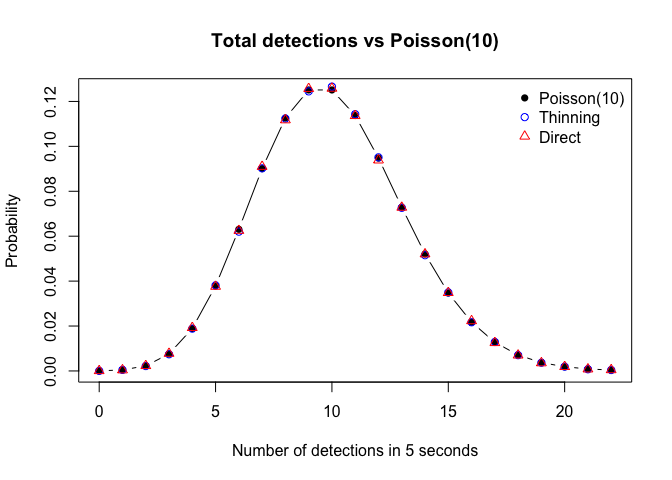
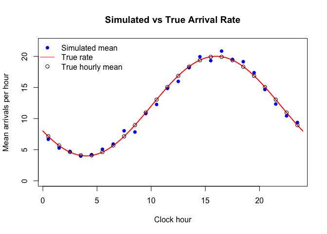
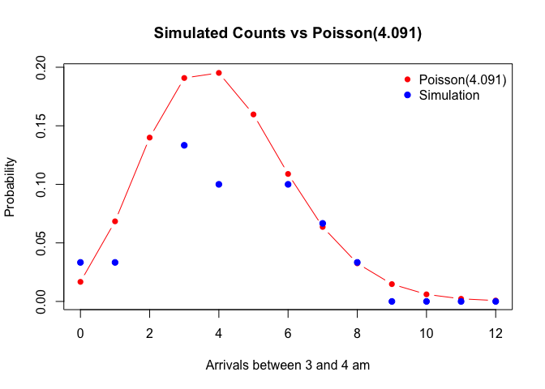
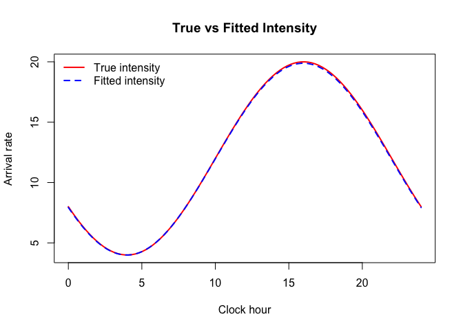

# HW8


## Question2 c

``` r
set.seed(123)

B <- 2e5
H <- 5
q <- 0.4
lambda_s <- 3
lambda_b <- 2
rate_s <- q * lambda_s
rate_b <- q * lambda_b
```

Simulate using two methods

``` r
# Method 1: Original photons followed by thinning
orig_s <- rpois(B, lambda_s * H)
orig_b <- rpois(B, lambda_b * H)

s1 <- rbinom(B, orig_s, q)
b1 <- rbinom(B, orig_b, q)

# Method 2: Directly simulate detected processes
s2 <- rpois(B, rate_s * H)
b2 <- rpois(B, rate_b * H)

sim1 <- data.frame(star = s1, sky = b1, total = s1 + b1)
sim2 <- data.frame(star = s2, sky = b2, total = s2 + b2)
```

Compare means, variances, and correlations

``` r
summarize_counts <- function(dat) {
  data.frame(
    Statistic = c("Mean star", "Variance star",
                  "Mean sky", "Variance sky",
                  "Mean total", "Variance total",
                  "Correlation star-sky"),
    Value = c(mean(dat$star), var(dat$star),
              mean(dat$sky), var(dat$sky),
              mean(dat$total), var(dat$total),
              cor(dat$star, dat$sky))
  )
}

comparison <- data.frame(
  Statistic = summarize_counts(sim1)$Statistic,
  Method1 = summarize_counts(sim1)$Value,
  Method2 = summarize_counts(sim2)$Value,
  Theory = c(6, 6, 4, 4, 10, 10, 0)
)

knitr::kable(comparison, digits = 4)
```

| Statistic            | Method1 | Method2 | Theory |
|:---------------------|--------:|--------:|-------:|
| Mean star            |  6.0037 |  5.9935 |      6 |
| Variance star        |  5.9797 |  5.9916 |      6 |
| Mean sky             |  4.0001 |  4.0016 |      4 |
| Variance sky         |  3.9850 |  3.9805 |      4 |
| Mean total           | 10.0039 |  9.9952 |     10 |
| Variance total       |  9.9622 |  9.9897 |     10 |
| Correlation star-sky | -0.0003 |  0.0018 |      0 |

Compare total counts with Poisson(10)

``` r
k <- 0:22
theory <- dpois(k, 10)

plot(k, theory, type = "b", pch = 16,
     xlab = "Number of detections in 5 seconds",
     ylab = "Probability",
     main = "Total detections vs Poisson(10)")

points(k, tabulate(sim1$total + 1, nbins = 23) / B,
       col = "blue", pch = 1)
points(k, tabulate(sim2$total + 1, nbins = 23) / B,
       col = "red", pch = 2)

legend("topright",
       legend = c("Poisson(10)", "Thinning", "Direct"),
       col = c("black", "blue", "red"),
       pch = c(16, 1, 2), bty = "n")
```



Probability of exactly 6 star photons given 10 detections

``` r
p6_1 <- mean(sim1$star[sim1$total == 10] == 6)
p6_2 <- mean(sim2$star[sim2$total == 10] == 6)
p6_theory <- dbinom(6, 10, 0.6)

data.frame(
  Method = c("Thinning", "Direct", "Theory"),
  Probability = c(p6_1, p6_2, p6_theory)
) |> knitr::kable(digits = 5)
```

| Method   | Probability |
|:---------|------------:|
| Thinning |     0.25117 |
| Direct   |     0.25054 |
| Theory   |     0.25082 |

First detection times of each kind

Given (N(5)=n\>0), the event times are distributed as the order
statistics of (n) independent Uniform(0,5) random variables.

If (N(5)=0), the first arrival occurs after 5 seconds, with an
additional exponential waiting time.

``` r
first_time <- function(counts, rate, H = 5) {
  t <- numeric(length(counts))
  has_event <- counts > 0

  t[has_event] <- H * (
    1 - runif(sum(has_event))^(1 / counts[has_event])
  )

  t[!has_event] <- H + rexp(sum(!has_event), rate)
  t
}

analyze_times <- function(dat) {
  ts <- first_time(dat$star, rate_s, H)
  tb <- first_time(dat$sky, rate_b, H)

  T_first <- pmin(ts, tb)
  star_first <- as.integer(ts < tb)
  M <- pmax(ts, tb)

  data.frame(
    Statistic = c("P(star first)",
                  "P(star first and within 1 s)",
                  "E[M]",
                  "Corr(first time, type)"),
    Value = c(mean(star_first),
              mean(star_first == 1 & T_first <= 1),
              mean(M),
              cor(T_first, star_first))
  )
}

time1 <- analyze_times(sim1)
time2 <- analyze_times(sim2)

time_comparison <- data.frame(
  Statistic = time1$Statistic,
  Method1 = time1$Value,
  Method2 = time2$Value,
  Theory = c(0.6,
             0.6 * (1 - exp(-2)),
             1 / 1.2 + 1 / 0.8 - 1 / 2,
             0)
)

knitr::kable(time_comparison, digits = 5)
```

| Statistic                    |  Method1 | Method2 |  Theory |
|:-----------------------------|---------:|--------:|--------:|
| P(star first)                |  0.60228 | 0.59925 | 0.60000 |
| P(star first and within 1 s) |  0.52106 | 0.51809 | 0.51880 |
| E\[M\]                       |  1.58301 | 1.58178 | 1.58333 |
| Corr(first time, type)       | -0.00052 | 0.00080 | 0.00000 |

## Question3 c

``` r
set.seed(123)

T <- 720
n_days <- 30
lambda_max <- 20

lambda <- function(t) {
  12 + 8 * cos(pi * (t - 16) / 12)
}

Lambda <- function(s, t) {
  12 * (t - s) +
    96 / pi * (sin(pi * (t - 16) / 12) -
               sin(pi * (s - 16) / 12))
}
```

Simulate 30 days by thinning

``` r
n_proposed <- rpois(1, lambda_max * T)
proposed_times <- sort(runif(n_proposed, 0, T))

keep <- runif(n_proposed) < lambda(proposed_times) / lambda_max
arrival_times <- proposed_times[keep]

n <- length(arrival_times)
fraction_kept <- n / n_proposed

data.frame(
  Proposed = n_proposed,
  Kept = n,
  Fraction_kept = fraction_kept,
  Theoretical_fraction = 0.6
) |> knitr::kable(digits = 4)
```

| Proposed | Kept | Fraction_kept | Theoretical_fraction |
|---------:|-----:|--------------:|---------------------:|
|    14332 | 8596 |        0.5998 |                  0.6 |

Mean arrivals by clock hour

``` r
day <- floor(arrival_times / 24) + 1
hour <- floor(arrival_times %% 24)

counts <- matrix(0, nrow = n_days, ncol = 24)

for (i in seq_along(arrival_times)) {
  counts[day[i], hour[i] + 1] <-
    counts[day[i], hour[i] + 1] + 1
}

hourly_mean <- colMeans(counts)
hours <- 0:23

true_hourly_mean <- sapply(hours, function(h) {
  Lambda(h, h + 1)
})

plot(hours + 0.5, hourly_mean,
     pch = 16, col = "blue",
     xlab = "Clock hour",
     ylab = "Mean arrivals per hour",
     main = "Simulated vs True Arrival Rate",
     ylim = c(0, 22))

curve(lambda(x), from = 0, to = 24,
      add = TRUE, col = "red", lwd = 2)

points(hours + 0.5, true_hourly_mean,
       pch = 1, col = "black")

legend("topleft",
       legend = c("Simulated mean", "True rate",
                  "True hourly mean"),
       col = c("blue", "red", "black"),
       pch = c(16, NA, 1),
       lty = c(NA, 1, NA),
       bty = "n")
```



Arrivals between 3 and 4 am

``` r
count_3to4 <- counts[, 4]
mu_true <- Lambda(3, 4)

comparison <- data.frame(
  Statistic = c("Mean", "Variance"),
  Simulation = c(mean(count_3to4), var(count_3to4)),
  Theory = c(mu_true, mu_true)
)

knitr::kable(comparison, digits = 4)
```

| Statistic | Simulation | Theory |
|:----------|-----------:|-------:|
| Mean      |     3.9667 | 4.0911 |
| Variance  |     3.8264 | 4.0911 |

``` r
k <- 0:max(12, max(count_3to4))

plot(k, dpois(k, mu_true),
     type = "b", pch = 16,
     col = "red",
     xlab = "Arrivals between 3 and 4 am",
     ylab = "Probability",
     main = "Simulated Counts vs Poisson(4.091)")

points(k, tabulate(count_3to4 + 1,
                   nbins = length(k)) / n_days,
       col = "blue", pch = 19)

legend("topright",
       legend = c("Poisson(4.091)", "Simulation"),
       col = c("red", "blue"),
       pch = c(16, 19),
       bty = "n")
```



Maximum likelihood estimation:

We fit

$\lambda(t)=a+b\cos\left(\frac{\pi(t-\phi)}{12}\right)$

Use the starting values $(a,b,\phi)=(10,5,14)$

``` r
neg_loglik <- function(theta, times, T) {
  a <- exp(theta[1]) + exp(theta[2])
  b <- exp(theta[2])
  phi <- theta[3]

  rates <- a + b * cos(pi * (times - phi) / 12)

  -sum(log(rates)) + T * a
}

start <- c(log(10 - 5), log(5), 14)

fit <- optim(
  par = start,
  fn = neg_loglik,
  times = arrival_times,
  T = T,
  method = "BFGS",
  control = list(maxit = 5000, reltol = 1e-12)
)

a_hat <- exp(fit$par[1]) + exp(fit$par[2])
b_hat <- exp(fit$par[2])
phi_hat <- fit$par[3] %% 24

loglik_nhpp <- -fit$value

estimates <- data.frame(
  Parameter = c("a", "b", "phi"),
  True = c(12, 8, 16),
  Estimate = c(a_hat, b_hat, phi_hat)
)

knitr::kable(estimates, digits = 4)
```

| Parameter | True | Estimate |
|:----------|-----:|---------:|
| a         |   12 |  11.9389 |
| b         |    8 |   7.9450 |
| phi       |   16 |  15.9834 |

``` r
fit$convergence
```

    [1] 0

Compare with the constant-rate model

For the homogeneous model, the MLE is

$\hat\lambda_0=\frac{n}{T}$

``` r
lambda_const <- n / T

loglik_const <- n * log(lambda_const) -
  lambda_const * T

lik_comparison <- data.frame(
  Model = c("NHPP", "Constant-rate HPP"),
  LogLikelihood = c(loglik_nhpp, loglik_const)
)

knitr::kable(lik_comparison, digits = 4)
```

| Model             | LogLikelihood |
|:------------------|--------------:|
| NHPP              |      13748.67 |
| Constant-rate HPP |      12720.37 |

``` r
loglik_difference <- loglik_nhpp - loglik_const
LRT <- 2 * loglik_difference

data.frame(
  LogLik_Difference = loglik_difference,
  LRT_Statistic = LRT
) |> knitr::kable(digits = 4)
```

| LogLik_Difference | LRT_Statistic |
|------------------:|--------------:|
|          1028.303 |      2056.606 |

Plot fitted intensity against true intensity

``` r
lambda_fit <- function(t) {
  a_hat + b_hat * cos(pi * (t - phi_hat) / 12)
}

curve(lambda(x), from = 0, to = 24,
      col = "red", lwd = 2,
      xlab = "Clock hour",
      ylab = "Arrival rate",
      main = "True vs Fitted Intensity")

curve(lambda_fit(x), from = 0, to = 24,
      add = TRUE, col = "blue",
      lwd = 2, lty = 2)

legend("topleft",
       legend = c("True intensity", "Fitted intensity"),
       col = c("red", "blue"),
       lty = c(1, 2), lwd = 2, bty = "n")
```


